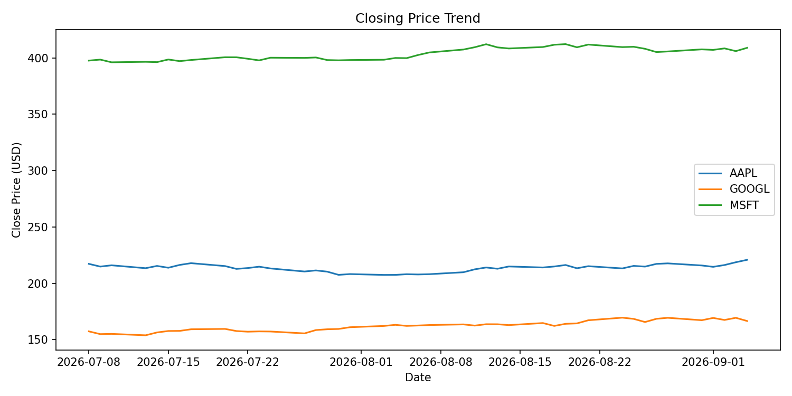

# Stock Market Data Pipeline

A small end-to-end data pipeline: pull daily stock prices from a REST API,
clean and structure them with pandas, load them into a SQL database, then
answer questions about the data with SQL and a chart.

Built as a portfolio project to practise (and demonstrate) the core stack
behind most Data Analyst / Data Scientist / Data Engineer roles: **REST
APIs, Python, pandas, SQL, and Git** — end to end, not just in isolation.

## Pipeline

```
fetch_data.py  ─▶  clean_data.py  ─▶  load_db.py  ─▶  analyze.py
(REST API call)    (pandas clean)     (SQL load)      (SQL + chart)
     │                   │                 │                │
data/raw/*.json   data/processed/    data/market_    outputs/
                   clean_prices.csv   data.db         closing_prices.png
```

Each stage reads the previous stage's output and writes its own — the same
pattern used in real data infrastructure, just scaled down to run on a
laptop with no cloud account required.

## Sample output



```
Average daily return by symbol:

symbol  avg_daily_return_pct  best_day_pct  worst_day_pct
 GOOGL                  0.140         1.910         -1.689
  MSFT                  0.068         0.729         -0.711
  AAPL                  0.043         1.239         -1.346
```

## Getting started

```bash
# 1. Clone and enter the repo
git clone https://github.com/priyanshuthakkur/stock-market-data-pipeline.git
cd stock-market-data-pipeline

# 2. Set up a virtual environment
python -m venv venv
source venv/bin/activate   # Windows: venv\Scripts\activate

# 3. Install dependencies
pip install -r requirements.txt

# 4. Add your free Alpha Vantage API key
cp .env.example .env
# then edit .env and paste your key from https://www.alphavantage.co/support/#api-key

# 5. Run the full pipeline
python run_pipeline.py
```

Or run each stage individually:

```bash
python src/fetch_data.py
python src/clean_data.py
python src/load_db.py
python src/analyze.py
python src/backtest.py          # optional: --short 10 --long 30 --cost-bps 5
```

Run the tests (no API key needed — they use mock data):

```bash
pip install pytest
pytest
```

## Project structure

```
stock-market-data-pipeline/
├── src/
│   ├── fetch_data.py     # REST API ingestion
│   ├── clean_data.py     # pandas cleaning & transformation
│   ├── load_db.py        # load into SQLite
│   ├── analyze.py        # SQL analysis + chart export
│   └── backtest.py       # moving-average strategy vs buy and hold
├── tests/
│   ├── test_clean_data.py
│   └── test_backtest.py
├── data/                 # raw/processed data & DB (mostly gitignored)
├── outputs/               # exported charts
├── run_pipeline.py        # runs all five stages in sequence
├── requirements.txt
└── .env.example
```

## Backtest: moving-average crossover vs buy and hold

`src/backtest.py` asks a simple trading question of the same data: would a
moving-average crossover rule have beaten just buying and holding each stock?

- **The rule:** hold the stock while its 10-day average closing price is above
  its 30-day average, otherwise hold cash (both windows are adjustable).
- **No look-ahead:** a signal from one day's close is only acted on the next
  day, so the strategy never uses prices it couldn't have known.
- **Fair comparison:** both approaches are measured over exactly the same days.
- **Trading costs:** each buy or sell is charged (5 basis points by default).
- **Reported for each stock:** total return, annual volatility, Sharpe ratio,
  maximum drawdown, number of trades and time in the market, plus a
  growth-of-$1 chart (`outputs/backtest_equity.png`).

**Limitations, stated plainly:**

- By default Alpha Vantage's compact feed gives about 100 trading days, which
  is far too short to judge a strategy. Set `ALPHA_VANTAGE_OUTPUTSIZE=full`
  in `.env` for a longer history if your API plan allows it.
- Prices are not adjusted for stock splits or dividends, so over long
  histories a split looks like a crash. An adjusted-price feed would fix this.
- One rule and one parameter pair tested on a few stocks is an exercise in
  testing an idea properly, not evidence of a profitable strategy. Trying many
  window pairs and keeping the best would overfit.

## Skills demonstrated

| Area | Where |
|---|---|
| REST API integration | `fetch_data.py` — `requests` against Alpha Vantage's live API |
| Data cleaning & transformation | `clean_data.py` — pandas, type coercion, derived columns |
| SQL & relational data modelling | `load_db.py`, `analyze.py` — schema design, indexing, aggregate queries |
| Data pipeline design | `run_pipeline.py` — staged, fail-fast orchestration |
| Backtesting | `backtest.py` — strategy vs benchmark, no look-ahead, trading costs, Sharpe and drawdown |
| Testing | `tests/` — pytest, mock API payloads and synthetic price series |
| Version control | commit history — staged, incremental commits rather than one dump |

## Extending this

The fetch → clean → load → analyze pattern here is deliberately generic —
swapping the API and the domain logic is enough to repurpose it. This is
the template for two companion projects: a healthcare version (image/tabular
data, tying into a deep learning dissertation) and a marketing analytics
version (engagement/campaign data with a dashboard layer).

## License

MIT — see [LICENSE](LICENSE).
